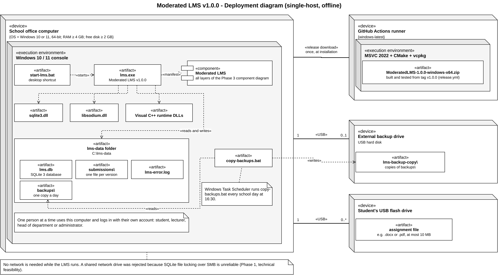

# Deployment (Phase 7)

How Moderated LMS is built, packaged and installed at the school (v1.0.0; unchanged in v1.1.0, which only adds the database migration described in `CR1_IMPACT_ANALYSIS.md`).

Editable sources: [deployment-diagram.drawio](diagrams/deployment-diagram.drawio) (draw.io) and [deployment-diagram.vsdx](diagrams/deployment-diagram.vsdx) (Visio).

## 1. Nodes and artefacts

| Node | Kind | What is deployed on it | Why |
|---|---|---|---|
| School office computer | «device», Windows 10 or 11, 64-bit | `lms.exe`, `sqlite3.dll`, `libsodium.dll`, the Visual C++ runtime DLLs, `start-lms.bat`, `copy-backups.bat`, and the data folder `C:\lms-data` | The whole system runs on one computer with no server and no network (NFR-04: every function works with the network switched off; NFR-03: Windows 10 or later; Phase 1 technical feasibility) |
| Windows 10 / 11 console | «execution environment» inside the computer | The console program | The presentation layer is a text console (Phase 3), so no browser or web server is needed |
| External backup drive | «device», USB hard disk | `lms-backup-copy\`, a copy of every daily backup | The database is a single point of failure; Phase 1 promised a daily copy to a second location |
| Student's USB flash drive | «device», removable | The assignment file a learner hands in | Learners bring work from home or the computer lab; the program copies it into `submissions\` |
| GitHub Actions runner | «device», `windows-latest` | Builds, tests and packages the release zip | Every release is built the same way from a tagged commit, so the school gets exactly the tested code |

`lms.exe` manifests the Moderated LMS component, which contains every layer of the Phase 3 component diagram (presentation, services, domain, data access and infrastructure). All five layers run in one process, so the layers are a logical structure, not separate deployment nodes.

## 2. Data on the school computer

| Artefact in `C:\lms-data` | Content | Created by |
|---|---|---|
| `lms.db` | The SQLite database: accounts, courses, assignments, submissions, marks, audit log | The program, on first start, from the schema built into `lms.exe` |
| `submissions\` | Every handed-in file, one per version | `LocalFileStore` |
| `backups\` | One backup folder per day (database and submitted files) | `BackupService`, at the first start each day |
| `lms-error.log` | Technical error details, never passwords | `ErrorLog` |
| `backup-copy.log` | What the scheduled copy did | `copy-backups.bat` |

The program and the data are kept in different folders (`C:\ModeratedLMS` and `C:\lms-data`), so installing a new version never touches the data. `start-lms.bat` always passes `C:\lms-data` to the program; this is the deployment fix for defect D15, where data seemed lost because the program was started from another folder.

## 3. Alternatives considered

| Option | Decision | Reason |
|---|---|---|
| One school computer, offline (chosen) | Supported | Matches the school: no reliable internet, no server, no IT staff on site. Simple to install and to back up |
| Database on a shared network drive, program on several computers | Rejected | SQLite's file locking over SMB network shares is unreliable and can corrupt the database (SQLite documentation; Phase 1 risk) |
| Client-server (database server, several clients) | Rejected for v1.0 | Needs a server computer, a network and someone to administer them; the school has none of these (Phase 1 operational feasibility) |
| Hosted web system (for example Moodle Cloud) | Rejected in Phase 1 | Needs reliable internet and raises data residency questions |
| Ship source code and let the school build it | Rejected | A technician would need a compiler, vcpkg and CMake. The release package contains a ready program instead |

The layered design keeps the client-server option open: only the data access layer knows about SQLite, so a later version could replace it with a server database without changing the services or the menus.

## 4. Build and release pipeline

| Step | Where | Tool |
|---|---|---|
| Every push: build, test, static analysis and a trial package | GitHub Actions, `ci.yml` | CMake, ctest, cppcheck, clang-tidy, `tools/package-windows.ps1` |
| Tag `vX.Y.Z` pushed: build, test, package, attach to the GitHub Release | GitHub Actions, `release.yml` | The same, plus `gh release` |
| Download the zip, carry it on USB, install | School | `docs/INSTALL.md` |

Because the package is made on every push, a broken packaging step is found in the pull request, before a release is tagged.

## 5. Documents for the school

| Document | Reader |
|---|---|
| [INSTALL.md](INSTALL.md) | School technician |
| [USER_MANUAL_STUDENT.md](manuals/USER_MANUAL_STUDENT.md) | Students |
| [USER_MANUAL_LECTURER.md](manuals/USER_MANUAL_LECTURER.md) | Lecturers |
| [USER_MANUAL_HEAD_OF_DEPARTMENT.md](manuals/USER_MANUAL_HEAD_OF_DEPARTMENT.md) | Heads of department |
| [USER_MANUAL_ADMINISTRATOR.md](manuals/USER_MANUAL_ADMINISTRATOR.md) | Administrator |
| [RELEASE_NOTES.md](RELEASE_NOTES.md) | Everyone: what the current version does and its known limitations |
